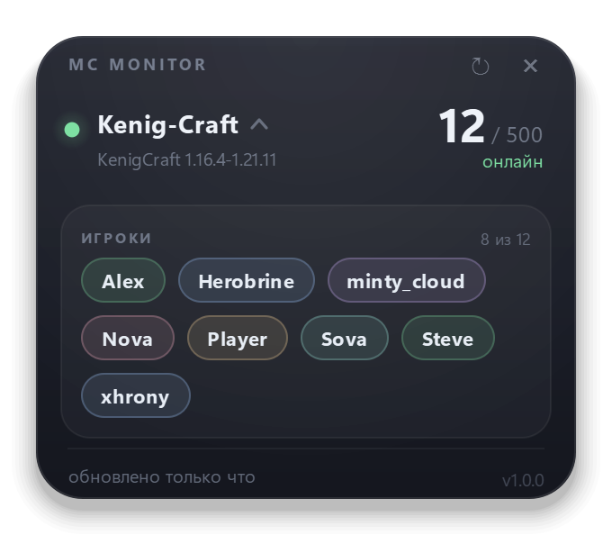

# 🟩 MC Monitor

Небольшое вертикальное окно для управления Minecraft-серверами и плавающий виджет поверх окон. Окно можно свернуть в системный трей; карточка остаётся перетаскиваемой, полупрозрачной и с мягкими анимациями.



## ✨ Что умеет

- 🟢 живая карточка с онлайном, версией и временем последней проверки;
- 👥 **список игроков**: клик по серверу — и под строкой раскрывается облачко с никами;
- 🖱 **перетаскивается** за любое место — поставь куда удобно;
- 🌫 **полупрозрачность**: `Ctrl` + колесо мыши или меню по правой кнопке;
- 🎯 **всегда сверху** — включается и выключается в том же меню;
- ✨ плавное появление, мягкое свечение статуса, анимация изменения числа игроков и раскрытия списка;
- 🔔 уведомления о входе/выходе отслеживаемых игроков и смене статуса сервера;
- 💾 запоминает позицию, прозрачность и закрепление между запусками;
- 🔄 два независимых API: если один лежит, используется второй;
- 🎛 поддержка нескольких серверов, у каждого своя строка и свой список игроков.
- 🪟 отдельное окно добавления и удаления серверов с тем же логотипом и иконкой, что в Android-приложении;
- 📌 показ выбранных серверов и групп в плавающем виджете;
- 🔔 закрытие главного окна сворачивает программу в системный трей.
- ☁️ аккаунт для синхронизации списка серверов с Android и другими устройствами.
- 🎨 локальные цвета интерфейса и виджета, горячая клавиша показа/скрытия виджета.
- 🔎 поиск раскрывается по нажатию и сразу фильтрует серверы; группы и приоритетные игроки настраиваются в контекстном меню.

## 🚀 Установка

Для Windows скачай `MC-Monitor-Setup-<версия>.exe` со
[страницы релизов](https://github.com/skyk0l/mc-monitor-pc/releases/latest) и запусти
мастер установки. По умолчанию приложение установится в Program Files; папку можно
изменить, а создание ярлыка на рабочем столе отмечено заранее. Настройки и данные
аккаунта хранятся отдельно в `%APPDATA%\MC Monitor`, поэтому установка в Program Files
не мешает сохранять изменения.

Для запуска из исходников нужен Python 3.10+ (проверено на 3.11):

```bat
py -3.11 -m pip install -r requirements.txt
```

## ▶️ Запуск

Двойной клик по **`run.bat`**. Откроются окно управления, плавающая карточка и значок программы в системном трее.

Если что-то не работает — **`run-console.bat`**, там видны ошибки. Логи всегда пишутся в `mcmonitor.log`.

Проверить серверы без окна:

```bat
py -3.11 -m mcmonitor --once
```

## 🖱 Управление

| Действие | Что делает |
| --- | --- |
| Зажать и тянуть | Переместить карточку |
| Клик по серверу | Раскрыть/свернуть список игроков |
| Колесо над списком | Прокрутить ники, если их много |
| ПКМ | Меню: обновить, игроки, настройки, прозрачность, выход |
| `Ctrl` + колесо | Плавно менять прозрачность (50–100%) |
| Наведение | Показывает кнопки «⟳ обновить» и «✕ закрыть» |
| Кнопка «Всегда сверху» | Закрепить поверх всех окон |
| Горячая клавиша из настроек | Показать или скрыть виджет |
| Закрыть главное окно | Свернуть программу в системный трей |
| Значок в системном трее | Открыть окно, показать виджет, обновить серверы или выйти |

Позиция и прозрачность сохраняются в `%APPDATA%\MC Monitor\window.json`.

## 👥 Список игроков

Кликни по строке сервера — карточка плавно вырастет, а под строкой появятся ники в мягких плашках:

- если ников много, список прокручивается колесом мыши;
- если сервер показывает только часть списка, справа будет подсказка вида «8 из 12»;
- если сервер скрывает ники (большие сети часто так делают), честно напишет «Сервер не показывает ники»;
- если никого нет — «Сейчас никого. Заходи первым 🌙»;
- если сервер офлайн — список появится, когда он оживёт.

Раскрыть список можно и через **ПКМ → «Игроки»**. Список обновляется вместе с онлайном при каждом опросе.

## ⚙️ Настройка

Добавляй и удаляй сервера кнопкой **«Добавить сервер»** в главном окне. В форме выбери Java Edition или Bedrock Edition. При первом запуске создаётся пустой **`servers.json`** в `%APPDATA%\MC Monitor`; старые настройки из папки с приложением переносятся туда автоматически. Старые записи без `protocol` считаются Java. Пример заполненного файла:

```json
{
  "poll_interval": 15,
  "notify_joins": true,
  "notify_offline": true,
  "notify_online": true,
  "servers": [
    {"name": "Java", "address": "play.example.com", "protocol": "java"},
    {"name": "Bedrock", "address": "play.example.com:19132", "protocol": "bedrock"}
  ]
}
```

| Поле | Что делает |
| --- | --- |
| `poll_interval` | Как часто проверять серверы, в секундах (по умолчанию и минимум 15) |
| `notify_joins` | Уведомлять о входе/выходе только заданных приоритетных игроков |
| `notify_offline` | Уведомлять, когда сервер упал |
| `notify_online` | Уведомлять, когда сервер поднялся |
| `servers` | Список серверов: `name` — подпись, `address` — `host` или `host:port`, `protocol` — `java` (по умолчанию) или `bedrock`; приоритетные игроки, группа и показ в виджете настраиваются в приложении |

После правки файла — **ПКМ → «Перечитать настройки»**, перезапуск не нужен.
Уведомления появляются при обнаруженном изменении статуса сервера или входе/выходе приоритетного игрока, а не по расписанию опроса. Источники статуса не отправляют приложению события сами: приложение опрашивает их каждые 15 секунд, и сами источники могут отдавать данные с задержкой. Старое значение по умолчанию `60` автоматически переводится на `15`.

## ☁️ Аккаунт и синхронизация

В сводке серверов есть кнопка аккаунта. Войди с тем же никнеймом на Android и ПК,
чтобы синхронизировать адреса, названия и протоколы серверов. В серверном JSON
поле `protocol` имеет значение `java` или `bedrock`; у старых записей без этого
поля используется `java`. Список остаётся доступен
локально без интернета; синхронизация выполняется при запуске, после изменений
и периодически. Сессия на Windows шифруется средствами DPAPI.

Первый вход объединяет серверы устройства и облака. При переключении на другой
аккаунт список заменяется его облачным списком, чтобы не смешивать данные.
Подготовка бесплатного проекта Supabase и настройка email-подтверждения описаны
в [SUPABASE_SETUP.md](./SUPABASE_SETUP.md). Профиль позволяет задать имя и описание,
загрузить JPEG-аватар, искать игроков и публичные серверы, подписываться на профили.
Публикация серверов отключена по умолчанию и включается владельцем отдельно.

## 🔔 Уведомления

- **Приоритетные игроки** — уведомление появляется только при входе/выходе ника, заданного для сервера; одно изменение количества игроков не создаёт уведомление.
- **Сервер упал / поднялся** — отдельные уведомления.
- Первая проверка никогда не спамит: состояние просто запоминается.

Уведомления появляются мягкой плашкой рядом с карточкой или в системном трее, если виджет скрыт.
На Windows приложение должно оставаться запущенным в системном трее; на Android
приоритетные ники проверяются в фоне примерно раз в 15 минут (Android может
отложить проверку из-за энергосбережения). Для синхронизации приоритетов между
устройствами войди в один аккаунт.

## 🚧 Ограничение для Velocity

Серверы за Velocity-прокси пока нельзя добавить в MC Monitor: поддержка таких подключений ещё не реализована.

## 🗂 Альтернативный режим трея

Только значок в трее без главного окна и плавающей карточки:

```bat
py -3.11 -m mcmonitor --tray
```

Там те же данные, но иконка в системном трее и системные уведомления.

## 🖼 Превью для README

```bat
py -3.11 -m mcmonitor --preview assets\widget-preview.png
```

Рисует карточку в PNG без запуска окна — удобно для скриншотов и гитхаба.

## 📦 Сборка в .exe

```bat
build.bat
```

Появится `dist\MC-Monitor.exe`. В установленной сборке настройки не хранятся рядом с exe: они лежат в `%APPDATA%\MC Monitor`, чтобы запись работала и при установке в Program Files.

## 🔄 Обновления и GitHub Actions

Приложение проверяет обновления при запуске и в меню системного трея. Для этого Windows-сборке нужен публичный GitHub-репозиторий: Actions записывает его адрес в `version.json` внутри exe. Если доступна новая версия, приложение скачивает установщик, проверяет размер и SHA-256 по GitHub Releases, затем открывает мастер установки. Для обновления текущая папка приложения уже выбрана; установщик заменяет файлы и может сразу запустить новую версию. При первой установке папка по умолчанию — Program Files. Старые переносные версии один раз предложат перейти на установщик; для них путь по умолчанию — Program Files.

Файл workflow находится в `.github\workflows\release.yml` в корне проекта. Запуск по тегу `vX.Y.Z` собирает Windows exe и публикует его как GitHub Release; версия тега должна совпадать с `mcmonitor.__version__`. Android публикует APK в [GitHub Releases](https://github.com/skyk0l/mc-monitor-android/releases); кнопку «Проверить обновления» можно найти внизу настроек приложения. Android скачивает и проверяет APK, затем открывает системный установщик — подтвердить обновление и при необходимости разрешить установку из этого источника должен пользователь. APK тестовых Actions runs остаются отдельными артефактами и не заменяют релизный файл.

## 🧱 Как это устроено

```
mcmonitor/
├─ auto_update.py # проверка GitHub Releases и автоустановка exe
├─ cloud_sync.py # Supabase Auth, RLS API и слияние списков
├─ widget.py     # окно на PySide6: отрисовка, анимации, перетаскивание, меню, список игроков
├─ main_window.py # окно управления серверами и системный трей
├─ ui_state.py   # window.json: позиция, прозрачность, «всегда сверху»
├─ tray.py       # альтернативный режим трея (pystray)
├─ api.py        # mcsrvstat.us + mcstatus.io, разбор ответов
├─ models.py     # ServerStatus: онлайн, ники, версия, MOTD
├─ config.py     # servers.json
├─ notify.py     # правила уведомлений
├─ icon.py       # иконка для трея и .exe
└─ cli.py        # запуск: виджет, --tray, --once, --preview
tests/
└─ test_offline.py   # проверки без интернета и без GUI
```

Проверки:

```bat
py -3.11 tests\test_offline.py
```

## 🧯 Если не работает

- **Сервер офлайн, хотя он онлайн** — сервер может быть закрыт от публичных API. Это ограничение провайдера, а не бага.
- **В списке игроков пусто, хотя онлайн не 0** — сервер скрывает ники. Это его настройка, снаружи её не обойти.
- **Не видно окно** — проверь, не уехало ли оно за край экрана: удали `%APPDATA%\MC Monitor\window.json`, карточка вернётся в правый нижний угол.
- **Ошибка `No module named PySide6`** — `py -3.11 -m pip install -r requirements.txt`.
- **Нет уведомлений** — проверь приоритетные ники в настройках сервера и разреши уведомления MC Monitor в настройках Windows.

## 💡 Идеи на потом

- [ ] мини-график онлайна за сутки
- [ ] звук при входе друга
- [ ] автозапуск с Windows
- [ ] несколько профилей серверов
- [ ] темы оформления (мятная, розовая, ночная)
- [ ] отдельные адреса режимов, если админы их выдадут

## Лицензия

MIT — бери и делай что хочешь.
